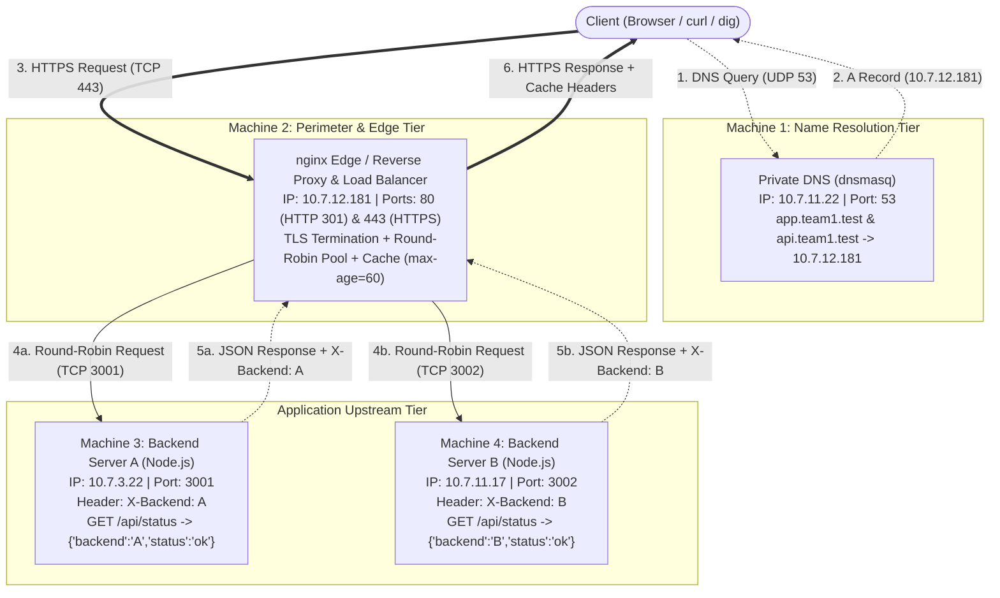

# Private Network Service Platform

A distributed, local-only private network platform demonstrating private DNS authoritative name resolution, edge reverse proxying, TLS 1.2/1.3 termination, Layer 7 round-robin load balancing, HTTP caching, and horizontally scalable backend microservices across four dedicated nodes.

Built as a Computer Networks Course Project.

---

## Team Members

- **Member 1:** [Name]
- **Member 2:** [Name]
- **Member 3:** [Name]
- **Member 4:** [Name]

---

## Architecture Diagram



---

## Machine & IP Allocation Matrix

| Machine | Role | IP | Port | Software / Services |
| :--- | :--- | :--- | :--- | :--- |
| **Machine 1** | Private DNS Server + Test Client | `10.7.11.22` | `53` (UDP/TCP) | `dnsmasq` |
| **Machine 2** | nginx Edge / Reverse Proxy & Load Balancer | `10.7.12.181` | `80` (HTTP), `443` (HTTPS) | `nginx`, OpenSSL / `mkcert` |
| **Machine 3** | Backend Server A | `10.7.3.22` | `3001` (TCP) | Node.js (`server.js`) |
| **Machine 4** | Backend Server B + Test Client | `10.7.11.17` | `3002` (TCP) | Node.js (`server.js`) |

> **Important:** Network-specific values and IP addresses are decoupled from application source code. They are configured via configuration files (`dnsmasq.conf`, `nginx.conf`) and environment templates (`.env.example`).

---

## Software Used

- **Operating System:** macOS (Sonoma / Sequoia / Ventura)
- **Package Manager:** Homebrew
- **DNS Server:** `dnsmasq` (v2.90+)
- **Reverse Proxy / Load Balancer:** `nginx` (v1.25+)
- **Application Runtime:** Node.js (v18+ LTS)
- **Cryptography / TLS:** OpenSSL 3.x or `mkcert` (Local Trusted CA)
- **Diagnostic & Testing CLI:** `curl`, `dig`, `nslookup`, `lsof`, `ping`
- **Network Packet Analyzer:** Wireshark (v4.x+)

---

## Request Flow

1. **Resolution Phase:**
   A client attempts to connect to `https://app.team1.test/api/status`. The client's operating system checks its resolver and sends a UDP DNS query on port 53 to **Machine 1** (`10.7.11.22`).
2. **DNS Answer:**
   Machine 1 (`dnsmasq`) intercepts the query and returns an authoritative `A` record pointing to the Edge Proxy on **Machine 2** (`10.7.12.181`).
3. **Transport & Security Handshake:**
   The client initiates a TCP 3-way handshake (`SYN` → `SYN-ACK` → `ACK`) with Machine 2 on port 443, followed immediately by a TLS 1.2 or 1.3 handshake including Server Name Indication (SNI) for `app.team1.test`. Machine 2 presents its multi-domain certificate and cryptographic keys are established.
4. **Perimeter Ingestion & Load Balancing:**
   Machine 2 decrypts the incoming HTTPS request. Its `upstream backend_pool` round-robin scheduler selects the next available backend in sequence (alternating between Backend A on `10.7.3.22:3001` and Backend B on `10.7.11.17:3002`).
5. **Upstream Request & Header Enrichment:**
   Machine 2 proxies the request over the internal network to the selected backend, attaching client provenance headers (`Host`, `X-Real-IP`, `X-Forwarded-For`, `X-Forwarded-Proto`).
6. **Backend Processing:**
   The receiving Node.js backend processes the request, injects its unique identifier header (`X-Backend: A` or `X-Backend: B`), and responds with JSON data `{"backend":"...","status":"ok"}`.
7. **Client Delivery:**
   Machine 2 receives the backend response, evaluates caching rules, appends diagnostic headers (`X-Served-By`, `X-Cache-Status`), encrypts the payload, and sends the response back to the client over TLS.

---

## DNS Setup

Machine 1 runs `dnsmasq`, a lightweight, authoritative caching DNS resolver.

Key configuration highlights from [machine1-dns/dnsmasq.conf.example](machine1-dns/dnsmasq.conf.example):
- `interface=en0`: Restricts listening to the active network adapter.
- `listen-address=127.0.0.1,10.7.11.22`: Binds the resolver to localhost and the private network IP.
- `bind-interfaces`: Prevents wildcard binding.
- `address=/app.team1.test/10.7.12.181`: Maps `app.team1.test` to Machine 2.
- `address=/api.team1.test/10.7.12.181`: Maps `api.team1.test` to Machine 2.
- `no-resolv`: Disables reading upstream public resolvers to enforce local network isolation.

For full setup commands and service management, see [machine1-dns/README.md](machine1-dns/README.md).

---

## nginx Reverse Proxy and Load Balancing

Machine 2 runs `nginx` as an edge reverse proxy and Layer 7 load balancer.

Key directives in [machine2-nginx/nginx.conf.example](machine2-nginx/nginx.conf.example):
- **Upstream Pool (`backend_pool`):**
  ```nginx
  upstream backend_pool {
      server 10.7.3.22:3001 max_fails=3 fail_timeout=10s;
      server 10.7.11.17:3002 max_fails=3 fail_timeout=10s;
      keepalive 32;
  }
  ```
  Nginx defaults to **Round-Robin** load balancing, distributing sequential requests equally across both nodes. Health monitoring via `max_fails=3` automatically marks an offline backend as inactive, rerouting traffic to the healthy peer.
- **Proxy Headers:**
  ```nginx
  proxy_set_header Host $host;
  proxy_set_header X-Real-IP $remote_addr;
  proxy_set_header X-Forwarded-For $proxy_add_x_forwarded_for;
  proxy_set_header X-Forwarded-Proto $scheme;
  proxy_pass_header X-Backend;
  ```
  Preserves client IP visibility for logging and propagates the backend identification header (`X-Backend`) to the client.

For detailed instructions, see [machine2-nginx/README.md](machine2-nginx/README.md).

---

## HTTPS / TLS Termination

Security is enforced at the perimeter on Machine 2:
1. **Port 80 Redirection:** Inbound cleartext HTTP traffic is redirected to HTTPS via:
   ```nginx
   server {
       listen 80;
       server_name app.team1.test api.team1.test;
       return 301 https://$host$request_uri;
   }
   ```
2. **TLS Termination (Port 443):**
   - Negotiates modern cipher suites using `TLSv1.2` and `TLSv1.3`.
   - Uses a multi-domain certificate with Subject Alternative Names (SAN) matching:
     - `DNS.1 = app.team1.test`
     - `DNS.2 = api.team1.test`
   - Offloads cryptographic CPU overhead from the application tier.
   - Private keys and certificates are protected and excluded via [.gitignore](.gitignore).

Certificate generation guidelines using both `mkcert` and OpenSSL are documented in [machine2-nginx/tls/README.md](machine2-nginx/tls/README.md).

---

## Backend Setup

The application tier consists of two independent Node.js services:
- **Backend A** ([backend-a/server.js](backend-a/server.js)): Hosted on Machine 3 (`10.7.3.22:3001`), injects header `X-Backend: A`.
- **Backend B** ([backend-b/server.js](backend-b/server.js)): Hosted on Machine 4 (`10.7.11.17:3002`), injects header `X-Backend: B`.

Both servers are implemented using the native Node.js `http` module without external runtime dependencies, guaranteeing instantaneous startup and portability in isolated private network environments.

---

## HTTP Caching

Reverse proxy caching is configured on Machine 2 using nginx's `proxy_cache` subsystem:
- **Zone Definition:**
  ```nginx
  proxy_cache_path /tmp/nginx_cache levels=1:2 keys_zone=STATIC_CACHE:10m max_size=100m inactive=60m use_temp_path=off;
  ```
- **Caching Behavior on `/cached/`:**
  - Cache responses with HTTP status `200` for 60 seconds (`proxy_cache_valid 200 60s;`).
  - Injects `Cache-Control: public, max-age=60` header.
  - Injects `X-Cache-Status: $upstream_cache_status` (returns `MISS` on first lookup, `HIT` on subsequent requests within 60 seconds).
  - During a cache `HIT`, nginx serves the response directly from memory/disk without dispatching a packet to Backend A or Backend B.

---

## How to Run Backend A

On **Machine 3**:

1. Clone or copy the repository onto Machine 3.
2. Enter the Backend A directory:
   ```bash
   cd backend-a
   ```
3. Initialize the environment file:
   ```bash
   cp .env.example .env
   ```
4. Start the server:
   ```bash
   node server.js
   # Or using npm:
   npm start
   ```
5. Confirm output:
   ```text
   ====================================================
    Private Network Service Platform - Backend A
   ====================================================
    Status      : Online
    Backend ID  : A
    Listening   : http://0.0.0.0:3001
    Health URL  : http://127.0.0.1:3001/api/status
   ====================================================
   ```

---

## How to Run Backend B

On **Machine 4**:

1. Clone or copy the repository onto Machine 4.
2. Enter the Backend B directory:
   ```bash
   cd backend-b
   ```
3. Initialize the environment file:
   ```bash
   cp .env.example .env
   ```
4. Start the server:
   ```bash
   node server.js
   # Or using npm:
   npm start
   ```
5. Confirm output:
   ```text
   ====================================================
    Private Network Service Platform - Backend B
   ====================================================
    Status      : Online
    Backend ID  : B
    Listening   : http://0.0.0.0:3002
    Health URL  : http://127.0.0.1:3002/api/status
   ====================================================
   ```

---

## How to Test DNS

From any client machine connected to the private network (or using Machine 1 directly):

```bash
# Query A record for app.team1.test via Machine 1
dig @10.7.11.22 app.team1.test

# Query A record for api.team1.test via Machine 1
dig @10.7.11.22 api.team1.test
```

Expected output snippet:
```text
;; ANSWER SECTION:
app.team1.test.     0   IN  A   10.7.12.181

;; ANSWER SECTION:
api.team1.test.     0   IN  A   10.7.12.181
```

You can also run the automated DNS test script:
```bash
./scripts/test-dns.sh 10.7.11.22
```

---

## How to Test the Backends

Verify each backend server independently from its host machine or across the private LAN:

### 1. Test Backend A Directly
```bash
curl -i http://10.7.3.22:3001/api/status
```
Expected response:
```http
HTTP/1.1 200 OK
Content-Type: application/json; charset=utf-8
X-Backend: A

{
  "backend": "A",
  "status": "ok"
}
```
Or run: `./scripts/test-backend-a.sh 10.7.3.22 3001`

### 2. Test Backend B Directly
```bash
curl -i http://10.7.11.17:3002/api/status
```
Expected response:
```http
HTTP/1.1 200 OK
Content-Type: application/json; charset=utf-8
X-Backend: B

{
  "backend": "B",
  "status": "ok"
}
```
Or run: `./scripts/test-backend-b.sh 10.7.11.17 3002`

---

## How to Test the Final Application Through the Domain Name

Ensure the client machine is configured to use Machine 1 (`10.7.11.22`) as its DNS server (or use `curl --resolve`).

### 1. Test Plaintext HTTP Port 80 (Redirect Check)
```bash
curl -i http://app.team1.test/api/status
```
Expected response:
```http
HTTP/1.1 301 Moved Permanently
Location: https://app.team1.test/api/status
```

### 2. Test Secure HTTPS via Domain Name
```bash
curl -k -i https://app.team1.test/api/status
```
*(Note: `-k` or `--insecure` is only required if the self-signed CA is not added to the client's system trust store).*

### 3. Test Load Balancing Across Sequential Requests
Execute the load balancing validation script:
```bash
./scripts/test-load-balancing.sh 10 https://app.team1.test/api/status
```
Observe sequential requests alternating between `X-Backend: A` and `X-Backend: B`.

### 4. Test in a Web Browser
Open macOS Safari or Google Chrome and navigate to:
```text
https://app.team1.test/api/status
```
Refresh the page repeatedly to observe the JSON response value toggling between `"backend": "A"` and `"backend": "B"`.

---

## Troubleshooting Guide

### 1. DNS Not Resolving
- **Symptom:** `dig` returns `connection timed out; no servers could be reached` or `NXDOMAIN`.
- **Resolution:**
  - Verify `dnsmasq` is running on Machine 1: `sudo brew services list` or `sudo ps aux | grep dnsmasq`.
  - Check binding address in `dnsmasq.conf`: ensure `listen-address` includes `10.7.11.22` and not only `127.0.0.1`.
  - Verify client resolver: check `/etc/resolv.conf` or run `scutil --dns`.

### 2. Ping Failure
- **Symptom:** `ping 10.7.x.x` returns `Request timeout` or `Destination Host Unreachable`.
- **Resolution:**
  - Ensure all 4 machines are connected to the same Wi-Fi SSID, switch VLAN, or subnet.
  - Verify IP assignments using `ifconfig en0 | grep inet`.
  - Check if ICMP echo requests are blocked by the macOS Stealth Mode firewall.

### 3. nginx Not Starting
- **Symptom:** `sudo nginx` errors or fails to launch.
- **Resolution:**
  - Run syntax validation: `sudo nginx -t`.
  - Check error logs: `tail -n 30 /var/log/nginx/error.log`.
  - Verify SSL certificate and key paths exist on disk: `/opt/homebrew/etc/nginx/certs/team1.test.crt`.

### 4. Port Already in Use
- **Symptom:** `bind() to 0.0.0.0:80 failed (48: Address already in use)` or `port 53 in use`.
- **Resolution:**
  - Identify the process holding the port:
    ```bash
    sudo lsof -i :53   # For DNS
    sudo lsof -i :80   # For HTTP
    sudo lsof -i :443  # For HTTPS
    sudo lsof -i :3001 # For Backend A
    sudo lsof -i :3002 # For Backend B
    ```
  - Stop macOS built-in Apache if running: `sudo apachectl stop`.
  - Kill orphaned processes using `kill -9 <PID>`.

### 5. Backend Unavailable (502 Bad Gateway)
- **Symptom:** Client receives `HTTP/1.1 502 Bad Gateway` from Machine 2.
- **Resolution:**
  - Check that Node.js servers are active on Machine 3 (`3001`) and Machine 4 (`3002`).
  - Test connectivity directly from Machine 2: `curl http://10.7.3.22:3001/api/status`.
  - Verify `upstream backend_pool` addresses and ports in `nginx.conf` match active backend machines.

### 6. TLS Certificate Problems
- **Symptom:** `curl: (60) SSL certificate problem: self signed certificate in certificate chain`.
- **Resolution:**
  - Use `curl -k` for quick testing during lab evaluations.
  - For full green-padlock verification, install the local CA root using `mkcert -install` or import `rootCA.pem` into the macOS System Keychain using:
    ```bash
    sudo security add-trusted-cert -d -r trustRoot -k /Library/Keychains/System.keychain rootCA.pem
    ```
  - Confirm the certificate has Subject Alternative Names (`SAN`) for both `app.team1.test` and `api.team1.test`.

### 7. Firewall Problems
- **Symptom:** Direct machine tests succeed locally (`127.0.0.1`), but remote machine queries time out.
- **Resolution:**
  - Check macOS Application Firewall status: `System Settings > Network > Firewall`.
  - Allow incoming connections for `dnsmasq`, `nginx`, and `node`.
  - If using macOS Packet Filter (`pf`), verify rules with `sudo pfctl -sr`.

---

## Phase 1 Evidence

Detailed milestone deliverables, configurations, and verification checklists for Phase 1 are documented in [docs/phase1.md](docs/phase1.md).

- **DNS Authoritative Queries:** [`evidence/dns/`](evidence/dns/README.md)
  - `dig` query terminal logs and Wireshark captures on UDP port 53.
- **Baseline Reverse Proxy & Handshake:** [`evidence/tcp/`](evidence/tcp/README.md)
  - TCP 3-way handshakes and single-backend HTTP forwarding captures.

---

## Phase 2 Evidence

Advanced features, load balancing traces, and cryptographic evidence for Phase 2 are documented in [docs/phase2.md](docs/phase2.md).

- **Layer 7 Load Balancing:** [`evidence/load-balancing/`](evidence/load-balancing/README.md)
  - Execution logs from `./scripts/test-load-balancing.sh` demonstrating sequential round-robin alternation between `Backend A` and `Backend B`.
  - Wireshark captures showing traffic distributed across ports 3001 and 3002.
- **TLS Termination & Handshake:** [`evidence/tls/`](evidence/tls/README.md)
  - Wireshark packet captures of `Client Hello` (with SNI), `Server Hello`, certificate negotiation, and encrypted application data.
  - HTTP 301 redirection logs from port 80 to port 443.
- **Reverse Proxy Caching:** [`evidence/caching/`](evidence/caching/README.md)
  - Header inspection demonstrating `X-Cache-Status: MISS` transitioning to `HIT` within the 60-second caching window.

---

## How to Run (Evaluator Quickstart)

Follow this numbered sequence to reproduce the entire environment from scratch:

### Step 1: Start Machine 1 (DNS)
1. Install `dnsmasq`: `brew install dnsmasq`
2. Copy configuration: `sudo cp machine1-dns/dnsmasq.conf.example /opt/homebrew/etc/dnsmasq.conf`
3. Start service: `sudo brew services start dnsmasq`
4. Verify: `dig @127.0.0.1 app.team1.test +short` (Returns `10.7.12.181`)

### Step 2: Start Machine 3 (Backend A)
1. In `backend-a/`: `cp .env.example .env`
2. Run server: `node server.js`
3. Verify: `curl http://127.0.0.1:3001/api/status` (Returns `{"backend":"A","status":"ok"}`)

### Step 3: Start Machine 4 (Backend B)
1. In `backend-b/`: `cp .env.example .env`
2. Run server: `node server.js`
3. Verify: `curl http://127.0.0.1:3002/api/status` (Returns `{"backend":"B","status":"ok"}`)

### Step 4: Start Machine 2 (Edge Proxy)
1. Install nginx: `brew install nginx`
2. Generate certificates following [machine2-nginx/tls/README.md](machine2-nginx/tls/README.md).
3. Copy configuration: `sudo cp machine2-nginx/nginx.conf.example /opt/homebrew/etc/nginx/nginx.conf`
4. Test and start: `sudo nginx -t && sudo nginx`

### Step 5: Run Automated Verification Suite
From a test client (e.g. Machine 1 or Machine 4):
```bash
# 1. Test DNS Resolution
./scripts/test-dns.sh 10.7.11.22

# 2. Test Backend A
./scripts/test-backend-a.sh 10.7.3.22 3001

# 3. Test Backend B
./scripts/test-backend-b.sh 10.7.11.17 3002

# 4. Test End-to-End HTTPS Load Balancing through nginx
./scripts/test-load-balancing.sh 10 https://app.team1.test/api/status
```

---

## Repository Structure

```
computer-networks-course-project/
│
├── README.md                           # Master Project Documentation & Evaluator Guide
├── LICENSE                             # MIT Open Source License
├── .gitignore                          # Excludes secrets, keys, certs, node_modules
│
├── docs/
│   ├── architecture.md                 # In-depth architectural design & request lifecycle
│   ├── network-topology.md             # Subnetting, ARP, IP matrix & packet traversal
│   ├── phase1.md                       # Phase 1 milestones (DNS + Single Backend HTTP)
│   └── phase2.md                       # Phase 2 milestones (Load Balancing + TLS + Caching)
│
├── machine1-dns/
│   ├── dnsmasq.conf.example            # Example configuration for authoritative DNS
│   └── README.md                       # Setup, interface binding, and test instructions
│
├── machine2-nginx/
│   ├── nginx.conf.example              # Edge proxy, upstream pool, TLS & caching config
│   ├── README.md                       # Installation, start/reload commands, troubleshooting
│   └── tls/
│       └── README.md                   # Multi-domain SAN certificate generation guide
│
├── backend-a/
│   ├── package.json                    # Project definition & npm start script
│   ├── server.js                       # Native Node.js HTTP server (X-Backend: A)
│   ├── .env.example                    # Network configuration template
│   └── README.md                       # Backend A documentation & curl test commands
│
├── backend-b/
│   ├── package.json                    # Project definition & npm start script
│   ├── server.js                       # Native Node.js HTTP server (X-Backend: B)
│   ├── .env.example                    # Network configuration template
│   └── README.md                       # Backend B documentation & curl test commands
│
├── evidence/
│   ├── README.md                       # Evidence submission index & Wireshark capture rules
│   ├── dns/
│   │   └── README.md                   # DNS query logs & packet capture instructions
│   ├── tcp/
│   │   └── README.md                   # TCP 3-way handshake & sequence diagrams
│   ├── tls/
│   │   └── README.md                   # TLS handshake, SNI, and cipher suites
│   ├── load-balancing/
│   │   └── README.md                   # Round-robin traffic logs & conversation stats
│   └── caching/
│       └── README.md                   # Cache hit/miss evidence & TTL expiration logs
│
└── scripts/
    ├── test-dns.sh                     # Automated DNS resolution testing script
    ├── test-backend-a.sh               # Direct Backend A verification script
    ├── test-backend-b.sh               # Direct Backend B verification script
    └── test-load-balancing.sh          # End-to-end HTTPS round-robin test script
```

---

## License

This project is licensed under the MIT License - see the [LICENSE](LICENSE) file for details.
