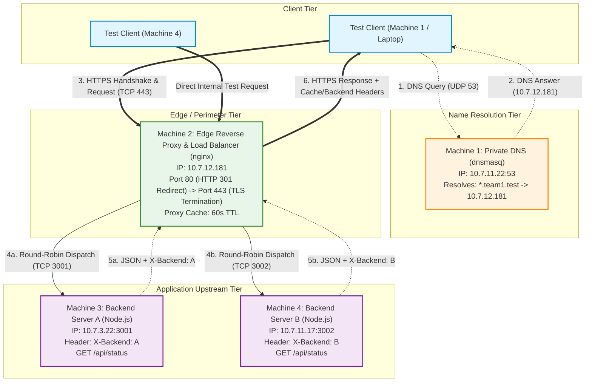

# System Architecture

## 1. Overview

The **Private Network Service Platform** is an enterprise-pattern, high-availability local network architecture constructed across four distinct physical/virtual machines. It models modern production infrastructure including private domain resolution, perimeter TLS termination, edge reverse proxying, Layer 7 load balancing, and independent horizontal backend application tiers.

The design strictly isolates private application servers behind an edge reverse proxy, ensuring that clients interact exclusively with a single unified entry point using human-readable domain names (`app.team1.test` and `api.team1.test`).

---

## 2. Architecture Diagram

---

## 3. Tier-by-Tier Architectural Breakdown

### 3.1. Name Resolution Tier (Machine 1)
- **Role:** Authoritative name server for the private domain `.team1.test`.
- **Software:** `dnsmasq`.
- **Rationale:** Prevents external DNS leakage. In enterprise environments, internal microservices and gateways must resolve via internal DNS split-horizon resolvers rather than public nameservers.
- **Record Mapping:**
  - `app.team1.test` → `10.7.12.181`
  - `api.team1.test` → `10.7.12.181`
- **Security:** `no-resolv` and `bind-interfaces` enforce strict locality.

### 3.2. Edge / Perimeter Tier (Machine 2)
- **Role:** Front-facing entry point, TLS terminator, Layer 7 load balancer, and caching proxy.
- **Software:** `nginx`.
- **Responsibilities:**
  1. **TLS Termination:** Terminates encrypted SSL/TLS sessions at the perimeter, relieving upstream backend servers from compute-heavy cryptographic negotiations.
  2. **Security & Redirection:** Plaintext port 80 traffic is redirected via HTTP `301 Moved Permanently` to port 443.
  3. **Load Balancing:** Implements Round-Robin distribution over `upstream backend_pool`.
  4. **Header Normalization:** Sanitizes and enriches forwarding headers (`Host`, `X-Real-IP`, `X-Forwarded-For`, `X-Forwarded-Proto`).
  5. **Edge Caching:** Operates an in-memory disk-backed cache for designated read-only paths (`/cached/`), reducing backend database or compute load.

### 3.3. Upstream Application Tier (Machines 3 & 4)
- **Role:** Business logic and data processing services.
- **Software:** Node.js standalone HTTP services (`server.js`).
- **Endpoints:**
  - `GET /api/status`: Emits machine-identifying payload `{"backend":"A"|"B","status":"ok"}`.
  - `GET /`: Emits metadata and runtime health metrics.
- **Isolation:** Backends are decoupled from public hostnames; they bind to their respective IP addresses on high-number non-privileged ports (`3001` and `3002`) and communicate over cleartext HTTP strictly within the perimeter.

---

## 4. End-to-End Request Lifecycle

1. **Resolution Phase:**
   The client requests resolution of `app.team1.test`. Machine 1 receives a UDP query on port 53 and replies with an `A` record pointing to `10.7.12.181`.
2. **Connection Establishment:**
   The client initiates a TCP 3-way handshake (`SYN`, `SYN-ACK`, `ACK`) with Machine 2 on port 443.
3. **Cryptographic Negotiation:**
   Client and Machine 2 perform a TLS 1.2 or 1.3 handshake:
   - Client sends `Client Hello` specifying `SNI: app.team1.test`.
   - Machine 2 replies with `Server Hello` and the Multi-Domain SAN X.509 Certificate.
   - Keys are established via ECDHE key exchange; session switches to AES-GCM encryption.
4. **Encrypted HTTP Transmission:**
   Client issues an encrypted `GET /api/status HTTP/1.1`.
5. **Upstream Proxying & Load Balancing:**
   Machine 2 decrypts the request, inspects the URI, and selects an upstream from `backend_pool` via round-robin:
   - Odd requests dispatched to `10.7.3.22:3001` (Backend A).
   - Even requests dispatched to `10.7.11.17:3002` (Backend B).
6. **Backend Processing:**
   The selected backend processes the request and responds with JSON and an identifying header (e.g. `X-Backend: A`).
7. **Edge Encapsulation & Response:**
   Machine 2 injects diagnostic headers (`X-Served-By`, `X-Cache-Status`), encrypts the response body via TLS, and transmits it to the client.

---

## 5. Fault Tolerance & Health Checking

The nginx upstream definition includes `max_fails=3` and `fail_timeout=10s`. If one backend becomes unreachable:
- Nginx automatically diverts subsequent requests to the healthy peer backend.
- Once the failed server resumes responding, it is automatically reintroduced into the round-robin cycle without downtime.
